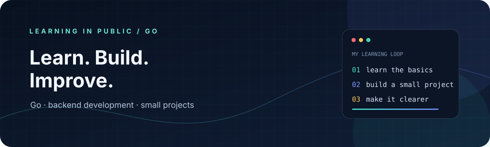

  

<a href="README.md">🇷🇺 Русский</a> &nbsp;·&nbsp; <strong>🇬🇧 English</strong>

<h1 align="center">olegval26 · Go &amp; backend</h1>

  <strong>Learning Go and the fundamentals of backend development</strong> 
  Small projects, practical experiments, and clear docs that make them easy to try.

  
  

## What I’m learning

I’m building my Go foundations and exploring how backend services are put together. I keep projects small, explain how to run them, and share what I learn along the way.

## Selected projects

<table>
  <tr>
    <td width="50%" align="center">
      
       
      <strong><a href="https://github.com/olegval26/vk-demoblaze-playwright">DemoBlaze · Cart Flow</a></strong>
       
      Go · Playwright · end-to-end testing
    </td>
    <td width="50%" align="center">
      
       
      <strong><a href="https://github.com/olegval26/CalcAt">CalcAt</a></strong>
       
      Java · Android · an educational calculator
    </td>
  </tr>
</table>

## How I approach projects

- Start with one clear problem.
- Make the result easy to run and understand.
- Improve the code and documentation as I learn.

  A growing collection of small, honest projects — one step at a time.

