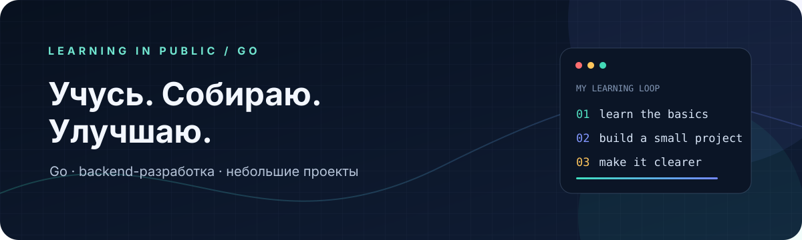

  

<strong>🇷🇺 Русский</strong> &nbsp;·&nbsp; <a href="README.en.md">🇬🇧 English</a>

<h1 align="center">Олег · Go и backend</h1>

  <strong>Изучаю Go и постепенно осваиваю backend-разработку</strong> 
  Небольшие проекты, практика и документация, по которой легко разобраться.

  
  

## Сейчас

Закладываю базу в Go и знакомлюсь с тем, как устроена backend-разработка. В проектах стараюсь показывать не только результат, но и как его запустить и проверить.

## Избранные проекты

<table>
  <tr>
    <td width="50%" align="center">
      
       
      <strong><a href="https://github.com/olegval26/vk-demoblaze-playwright">DemoBlaze · Cart Flow</a></strong>
       
      Go · Playwright · end-to-end тестирование
    </td>
    <td width="50%" align="center">
      
       
      <strong><a href="https://github.com/olegval26/CalcAt">CalcAt</a></strong>
       
      Java · Android · учебный калькулятор
    </td>
  </tr>
</table>

## Как я подхожу к проектам

- Начинаю с одной понятной задачи.
- Делаю запуск и результат простыми для проверки.
- Улучшаю код и документацию по мере обучения.

  Небольшие проекты, честный прогресс и следующий шаг за следующим.

